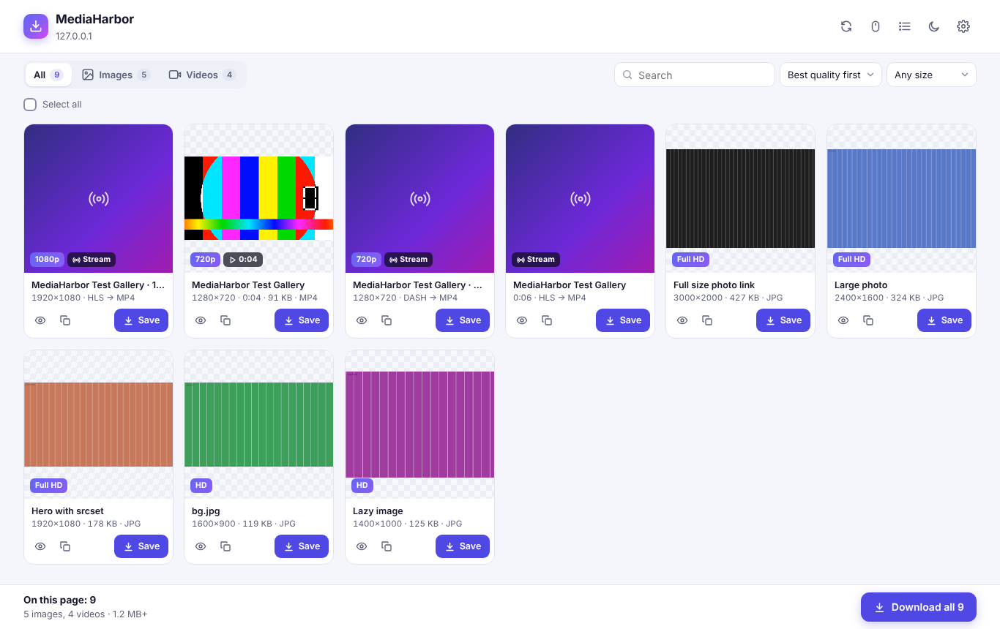
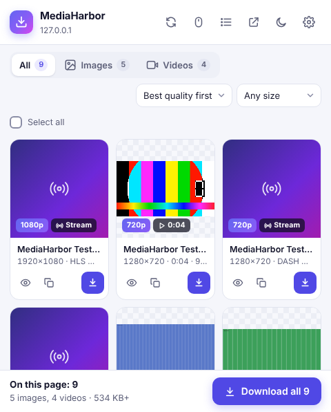
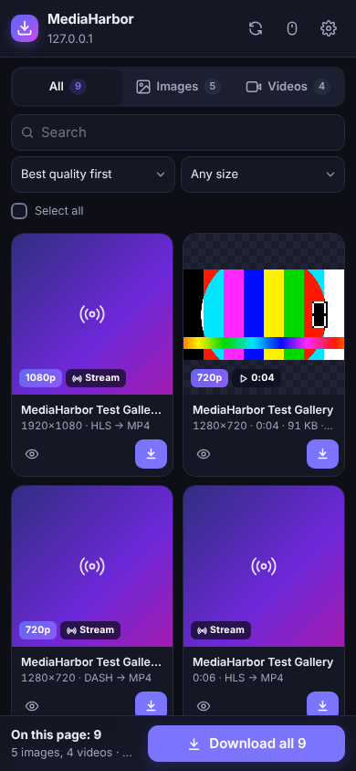
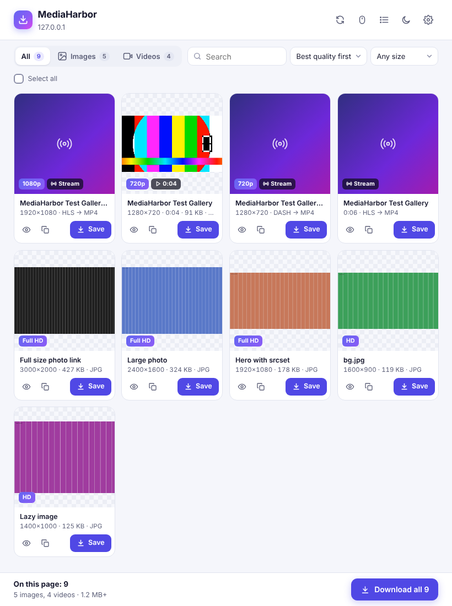
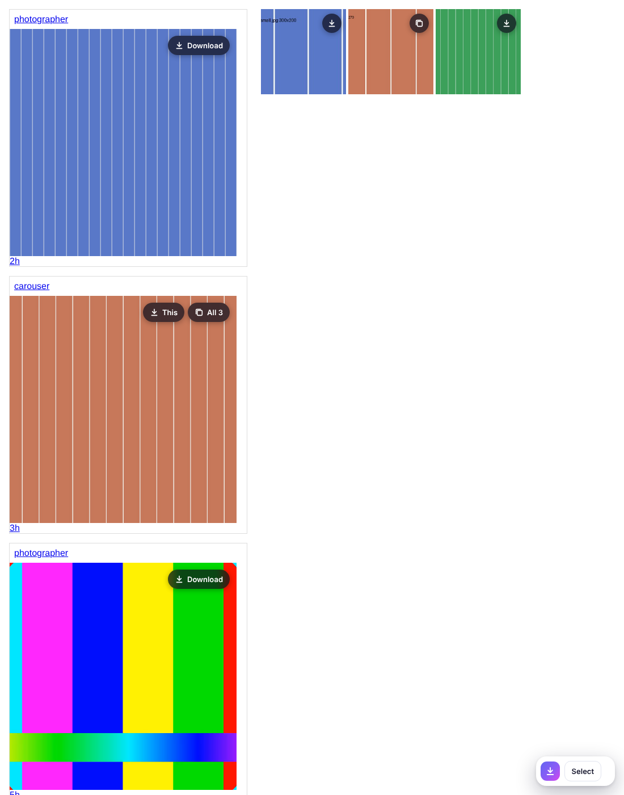

# MediaHarbor – Image & Video Downloader for Chrome

Save images and videos **in the best available quality** from Instagram, Facebook, X (Twitter), TikTok, Threads and almost any other website.



| Popup | Phone width | Tablet |
|---|---|---|
|  |  |  |

## Features

- **Finds everything**: images, `srcset`/`<picture>` sources, lazy-loaded images, CSS backgrounds, linked full-size photos, `<video>`, Open Graph media, and video streams seen on the network.
- **Best quality automatically**:
  - picks the largest `srcset` image
  - turns thumbnails into originals on X, Pinterest, Reddit, Wikimedia, Amazon, WordPress, Shopify, Google/Blogger, Imgur, Flickr, Unsplash, Cloudinary and imgix
  - picks the highest HLS/DASH quality
  - reads the HD links that Instagram, Facebook, X and TikTok load in the page
- **Streams to MP4**: downloads HLS (`.m3u8`, including AES-128) and DASH (`.mpd`), then joins video + audio into one MP4 with ffmpeg.wasm. Stream copy only, so there is no quality loss.
- **Responsive UI**: toolbar popup plus a full-page manager for desktop, tablet and phone-sized windows. Light/dark theme, search, filters, preview, keyboard shortcuts.
- **Organised files**: `Downloads/MediaHarbor/<website>/<name>.<ext>` (you can change this in Settings).
- **Right-click menu**: *Save in best quality* on any image or video.
- **Download buttons inside Instagram** (new in 1.1):
  - **Feed and post pages**: a *Download* button on every post. Carousels get *This* (the slide you are looking at) and *All N*.
  - **Reels and stories**: a *Download* button on the video or photo.
  - **Profile, Explore/search, hashtag, saved and tagged grids**: a round button on every tile that saves the whole post.
  - **Bulk**: press *Select* in the bar at the bottom right, tick posts (or *Select all*), then *Download N*.
  - Files are named `username_POSTCODE.jpg`, or `username_POSTCODE_2.mp4` for carousels, in full quality. HD reels are joined from video + audio.
  - You can switch the buttons off in Settings → *Download buttons on Instagram*.



## Install (developer mode, 2 minutes)

1. Download `MediaHarbor-v1.1.0.zip` and **unzip** it into a folder you will keep.
   Or clone this repository and use the `extension/` folder.
2. Open Chrome and go to `chrome://extensions`.
3. Switch on **Developer mode** (top-right corner).
4. Click **Load unpacked** and choose the unzipped folder (the one with `manifest.json`).
5. Pin MediaHarbor in the toolbar (puzzle icon → pin). Shortcut: **Alt+Shift+D**.

It also works in other Chromium browsers that support Chrome extensions (Edge, Brave, Opera, Vivaldi). I have only tested it in Chromium.

## How to use

1. Open a page with photos or videos. For videos, press play once so the stream starts loading.
2. Click the MediaHarbor icon. The best-quality items are listed first.
3. Click **Save** on one item, or **Download all**. Select items with the checkboxes to download only those.
4. On feeds (Instagram, Pinterest…), press the **mouse icon (Load more)** to scroll the page automatically and find more posts.
5. Click the **open-in-tab icon** for the big manager view.

## Limits

- **YouTube and streaming services** (Netflix, Disney+, Prime Video, Hulu, Max, Spotify): video download is switched off. The Chrome Web Store does not allow YouTube downloaders, and these services use DRM copy protection. Thumbnails and images still work.
- **DRM-protected videos** cannot be downloaded and are marked *Protected*.
- **Live streams** can be saved after they end.
- **Chrome on Android/iPhone does not support extensions.** The phone layout is for narrow windows and for mobile Chromium browsers that can load Chrome extensions (not tested; this needs verification).
- Social sites change their code often, so some sites may need rule updates later. The Instagram buttons were tested on test pages that copy Instagram's layout and data, not on the live Instagram site. Small fixes may be needed after real use.
- For grid posts that were never loaded, MediaHarbor asks Instagram's web API for the post data using your own login. Bulk downloads are spaced out, but downloading very many posts quickly may still trigger Instagram's rate limits.
- Very large videos (multi-GB) are processed in memory and may fail.

**Please respect copyright.** Only download content you own or have permission to use, and follow each website's terms.

## Privacy

MediaHarbor has no servers, no analytics and no tracking. Everything happens in your browser. It only contacts the websites you visit, to download the files you choose.

## Development

```bash
npm install            # installs Playwright for the browser tests
npm run test:unit      # URL rules + social-media extractor
npm run test:e2e       # loads the extension in Chromium against a local test site (needs python3, ffmpeg/ffprobe, openssl)
npm run package        # builds dist/MediaHarbor-v<version>.zip
```

Project layout and design decisions: see [PLAN.md](PLAN.md).

## Third-party software

- [ffmpeg.wasm](https://github.com/ffmpegwasm/ffmpeg.wasm) `@ffmpeg/ffmpeg` 0.12.15: MIT license.
- `@ffmpeg/core` 0.12.10 (FFmpeg compiled to WebAssembly): **GPL-2.0-or-later**.

If you publish or share the extension, the GPL license of `@ffmpeg/core` applies to that copy. For example, you must make the source code available. This is not legal advice; please check the license terms before publishing.
